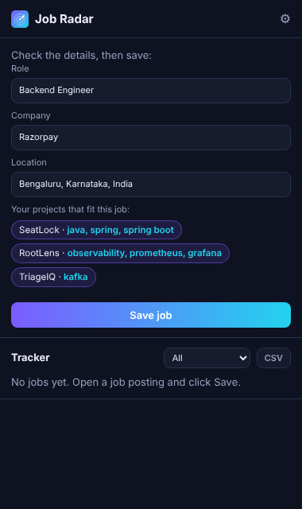
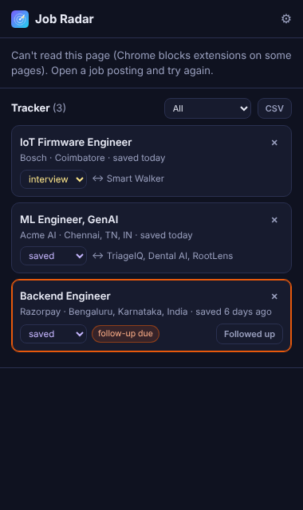

# 📡 Job Radar

**Save any job in one click, get nudged to follow up, and see which of your projects fit it.**

Works on **LinkedIn**, **Naukri** and most **company careers pages** (Greenhouse, Lever, Workday and anything that publishes standard job data).

<p align="center"> &nbsp; </p>

## What it does

- **One-click capture:** open a job, click the icon. Role, company and location are filled in for you (and editable).
- **Project matching:** reads the job description and shows which of *your* projects fit, with the keywords that matched, e.g. *SeatLock · java, spring, kafka*. Great for picking what to talk about in the application.
- **Tracker:** every saved job with its status: saved → applied → interview → offer / rejected.
- **Follow-up reminders:** 5 days after you save a job that's still *saved* or *applied*, you get a Chrome notification and the job is highlighted. The icon badge shows how many follow-ups are due.
- **CSV export:** download your whole tracker for Excel or Google Sheets.

## How it finds the job details

1. **Structured job data** (`schema.org/JobPosting`) that most careers sites include for Google Jobs.
2. **Site layouts** for LinkedIn and Naukri.
3. **Fallback:** the page title and main text.

If something comes out wrong, just edit the field before saving.

## Your projects

Click ⚙ in the popup to edit the project list: a name, a link and comma-separated keywords per project. Matching is whole-word, so `java` doesn't match "javascript".

## Privacy

- It reads a page **only when you click the button** (`activeTab`). There's no access to your browsing otherwise.
- Everything is stored **locally** in your browser (`chrome.storage.local`). Nothing is sent anywhere.

| Permission | Why |
|---|---|
| `activeTab`, `scripting` | read the job page you're on, only when you click |
| `storage` | keep your tracker and project list |
| `alarms`, `notifications` | the 5-day follow-up reminder |

## Install (2 minutes)

1. Download this repo: **Code → Download ZIP**, then unzip it (or `git clone` it).
2. Open `chrome://extensions` in Chrome (or Edge / Brave).
3. Turn on **Developer mode** (top right).
4. Click **Load unpacked** and choose the unzipped folder (the one with `manifest.json`).
5. Pin it from the 🧩 puzzle-piece menu so it is one click away.

## Built with

Manifest V3, plain JavaScript (ES modules), no frameworks, no build step, no servers.

## Tests

`tests/test.js` loads the extension into headless Chromium with [Playwright](https://playwright.dev), opens realistic mock pages and checks the results end to end (screenshots go to the folder you pass in):

```bash
npm i -D playwright && npx playwright install chromium
node tests/test.js /tmp
```
